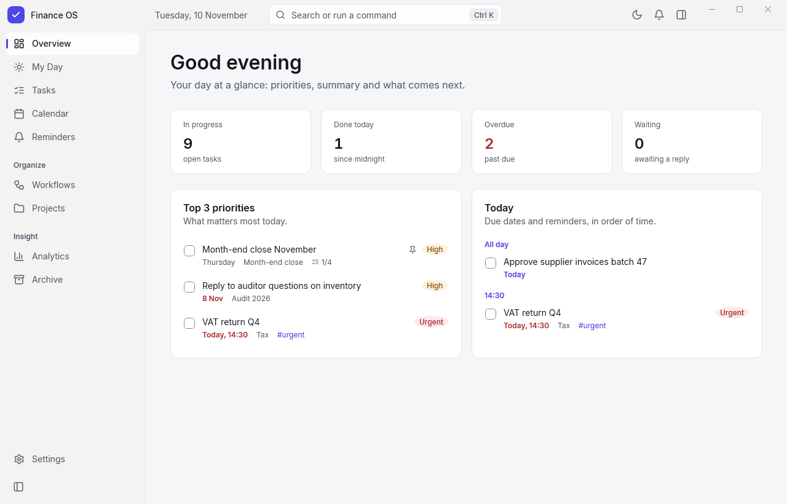
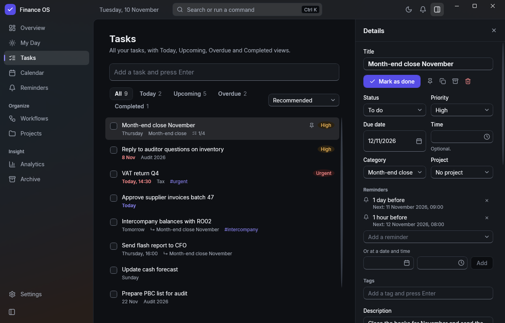
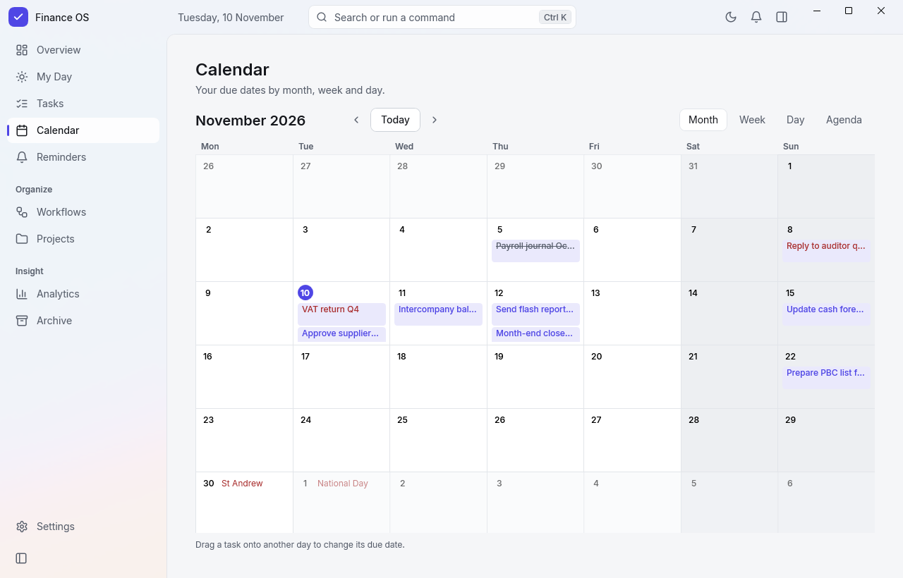
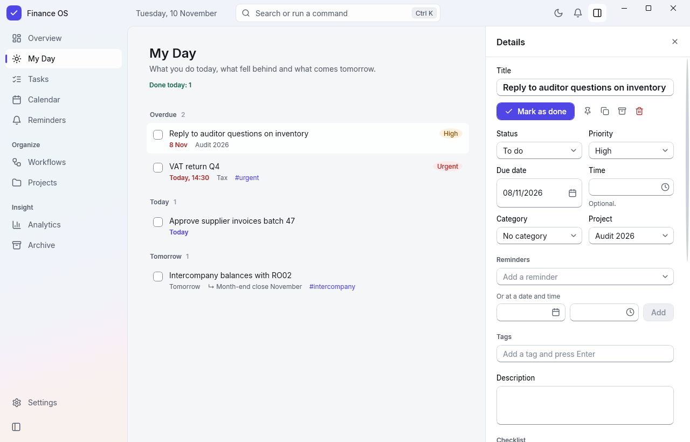
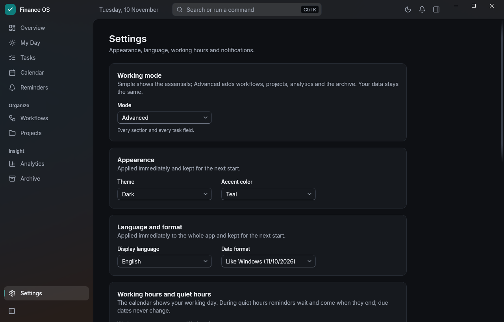
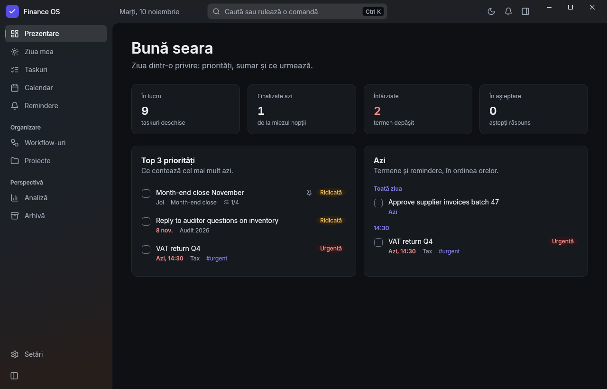
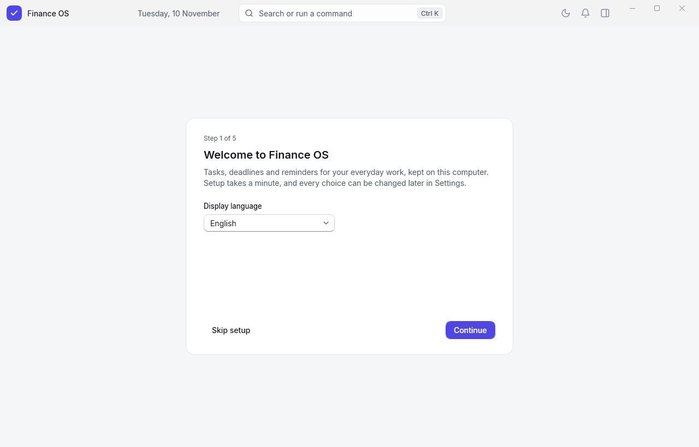
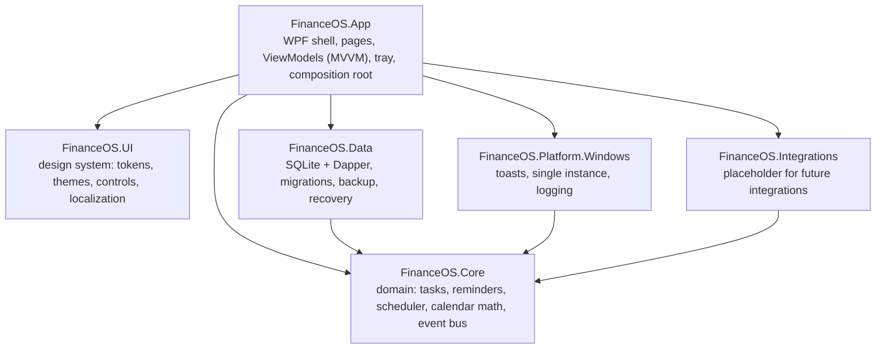

# Finance OS

A Windows desktop app that organizes a finance employee's workday: tasks, a daily view, a calendar and reminders that fire even when the app is closed.

Built with WPF on .NET 10 and SQLite. Runs as a single portable `.exe` with no installation and no administrator rights.

## The problem

People in finance operations (accounts payable/receivable, controlling, accounting) work through recurring deadlines, follow-ups and small tasks spread across the day, often on locked-down corporate laptops where they cannot install software. Finance OS is a local, offline task and reminder tool built for that environment:

- no admin rights, no runtime to install, no cloud account;
- all data stays on the machine (`%LOCALAPPDATA%\FinanceOS`);
- reminders arrive as native Windows notifications, also while the app is closed.

## Features

- **Tasks**: quick add (Ctrl+N), views for All / Today / Upcoming / Overdue / Completed, sorting, inline editing in a side panel, priorities, categories, projects, tags, checklists, one level of subtasks, pinning, duplicate, archive, trash with restore.
- **Undo**: the last 50 actions of the session (Ctrl+Z), including multi-entity changes such as a parent with its subtasks. Undo is refused if the entity changed in the meantime.
- **My Day and Overview**: overdue / today / tomorrow, counters, top 3 priorities and the day's timeline.
- **Reminders**: relative to the due date or at a fixed time, several per task, snooze (5–60 min, tomorrow), "Done" directly from the Windows notification, an in-app notification center, quiet hours and weekends.
- **Calendar**: month, week, day and agenda views, drag-and-drop rescheduling with confirmation, Romanian public holidays (including Orthodox Easter, computed).
- **Search and command palette** (Ctrl+K), diacritic-insensitive, backed by SQLite FTS5.
- **English / Romanian**, switched live without restart; dates follow the chosen language and format.
- **Simple / Advanced modes**, light/dark theme following Windows, 8 accent colors, a 5-step first-run guide with optional sample data.
- **Data safety**: daily and pre-migration backups, an integrity check at every start, a recovery screen when the database is damaged, and log files with personal data redacted.
- **Tray icon, single instance, optional start with Windows** (per-user, opt-in).

## Demo

Screenshots of the real app window, taken with `build/capture-window.ps1` on fictitious sample data (`--seed`).

**Overview**: counters, top 3 priorities and the day's timeline.



**Tasks**: views with counts, quick add, and the details panel with inline editing and reminders (dark theme).



**Calendar**: month view with due dates, completed tasks struck through, weekends and Romanian public holidays.



<details>
<summary>More screenshots: My Day, Settings, Romanian UI, first-run guide</summary>

**My Day**: overdue, today and tomorrow, with the details panel.



**Settings**: Simple / Advanced mode, theme, accent color (teal here), language and date format.



**Romanian interface**: the same Overview with the language switched to Romanian.



**First-run guide**, step 1 of 5.



</details>

## Architecture

Six projects with dependency rules enforced by a test (`tests/FinanceOS.Architecture.Tests`). The domain layer is plain .NET with no UI, database or Windows dependencies.



| Layer | Technology |
|---|---|
| Runtime | .NET 10, `net10.0-windows10.0.19041.0`, Windows 10 1809+ |
| UI | WPF with a custom design system (no third-party theme toolkit), Inter font, Lucide icons |
| MVVM / DI | CommunityToolkit.Mvvm, Microsoft.Extensions.DependencyInjection |
| Storage | SQLite (`Microsoft.Data.Sqlite`) + Dapper, WAL, `STRICT` tables, FTS5, versioned SQL migrations |
| Notifications | `Microsoft.Toolkit.Uwp.Notifications` (scheduled toasts with actions), `H.NotifyIcon.Wpf` (tray) |
| Time | `TimeProvider`; `FakeTimeProvider` in tests |
| Tests | xUnit v3 on Microsoft.Testing.Platform; 530 automated tests (domain, SQLite, WPF ViewModels and rendering, architecture rules) |
| Build | Central Package Management, nullable enabled, warnings as errors, single-file self-contained publish |

### NuGet packages

All versions are pinned centrally in [`Directory.Packages.props`](Directory.Packages.props).

| Package | Version | Used in | Purpose |
|---|---|---|---|
| [CommunityToolkit.Mvvm](https://www.nuget.org/packages/CommunityToolkit.Mvvm) | 8.4.2 | App | MVVM source generators (observable properties, relay commands) |
| [Microsoft.Extensions.DependencyInjection](https://www.nuget.org/packages/Microsoft.Extensions.DependencyInjection) | 10.0.13 | App | Composition root / dependency injection |
| [Microsoft.Data.Sqlite](https://www.nuget.org/packages/Microsoft.Data.Sqlite) | 10.0.13 | Data | SQLite provider (bundled native SQLite with FTS5) |
| [Dapper](https://www.nuget.org/packages/Dapper) | 2.1.89 | Data | Explicit SQL with lightweight object mapping |
| [Microsoft.Extensions.Logging](https://www.nuget.org/packages/Microsoft.Extensions.Logging) | 10.0.13 | App | Logging pipeline (with a custom redacting file sink) |
| [Microsoft.Extensions.Logging.Abstractions](https://www.nuget.org/packages/Microsoft.Extensions.Logging.Abstractions) | 10.0.13 | Data, Platform | Logging interfaces |
| [Microsoft.Toolkit.Uwp.Notifications](https://www.nuget.org/packages/Microsoft.Toolkit.Uwp.Notifications) | 7.1.3 | Platform | Windows toast notifications with actions, scheduled toasts |
| [H.NotifyIcon.Wpf](https://www.nuget.org/packages/H.NotifyIcon.Wpf) | 2.4.1 | App | System tray icon with a WPF context menu |
| [xunit.v3](https://www.nuget.org/packages/xunit.v3) | 4.0.2 | all test projects | Test framework (Microsoft.Testing.Platform runner) |
| [Microsoft.Extensions.TimeProvider.Testing](https://www.nuget.org/packages/Microsoft.Extensions.TimeProvider.Testing) | 10.0.0 | Data.Tests | `FakeTimeProvider` for deterministic reminder/scheduler tests |

## Technical challenges

- **Reminders while the app is closed.** On exit and before sleep, the next 7 days of reminders (at most 50) are handed to Windows as scheduled toasts. On start, resume, unlock or a clock change the app reconciles: what Windows already showed appears in the notification center, occurrences older than 5 minutes are grouped into one "missed reminders" summary, recent ones are delivered, and the scheduled toasts are withdrawn so nothing fires twice.
- **Testable timing.** The in-app scheduler uses one timer to the next occurrence plus a 60-second safety check. All time goes through `TimeProvider`, so tests for delivery, snooze, rescheduling, restart and DST changes run instantly with `FakeTimeProvider`.
- **Migrations that cannot silently half-run.** `SqliteCommand.ExecuteNonQuery` stops without error after a statement that returns rows, skipping the rest of a script. Migrations therefore run statement by statement (`SqlScript`), each migration in one transaction, with a checksum that rejects edited migrations and a refusal to open a database newer than the app. A test covers the original failure.
- **Undo across related entities.** Each command writes the entities and `activity_log` rows (before/after JSON plus a batch id) in one transaction, then publishes events after commit. Undo replays the exact inverse of a whole batch and is refused if the data changed since.
- **Isolated test instances.** A test or smoke-run instance with its own data folder (`FINANCEOS_DATA_ROOT` / `--data-root`) could withdraw toasts scheduled by the real installation. Separate data folders now never schedule or withdraw Windows toasts.
- **Locked-down machines.** The single-file build extracts native WPF DLLs to `%TEMP%`, which some policies block. The release script also produces a variant with the DLLs next to the exe.
- **Live localization.** A `{loc:Tr Key}` markup extension binds to a localizer indexer, so switching language updates templates and setters without a restart. Tests check that both languages have the same keys and placeholders and that the app's XAML contains no hard-coded text.
- **WPF UI tests.** Tests that build real WPF visual trees run sequentially, because in parallel they hung intermittently under `dotnet test`.

## Running it

Requirements: Windows 10/11 and the .NET SDK version pinned in `global.json`.

```powershell
dotnet build FinanceOS.slnx
dotnet test --solution FinanceOS.slnx
dotnet run --project src/FinanceOS.App
```

The app needs no configuration, secrets or external services. Its data lives in `%LOCALAPPDATA%\FinanceOS`. To keep a demo separate from real data, point it at another folder:

```powershell
$env:FINANCEOS_DATA_ROOT = "$env:TEMP\FinanceOS-demo"
dotnet run --project src/FinanceOS.App
```

On first start, the guide's last step offers fictitious sample tasks, which can later be removed in one step from Settings. Debug builds also accept `--seed` to fill an empty database with sample tasks.

Portable release zips: `build/release.ps1`.

## Status

Version 0.1.0 (portable release). [TODO: current status and next steps]

## Notes

- Code comments reference sections of an internal design document (`ARCHITECTURE.md §…`) that is not part of this repository.
- Third-party components (Inter font, Lucide icons) keep their own licenses; see [THIRD-PARTY-NOTICES.md](THIRD-PARTY-NOTICES.md).

---

Portfolio project, not open source. © 2026 Petcu Iulian. All rights reserved. See [LICENSE](LICENSE).
